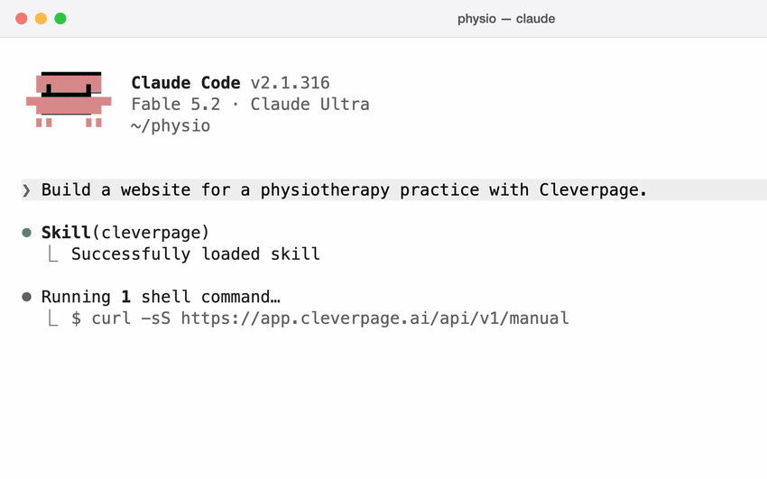

# Cleverpage-Skill für KI-Agenten

[English version](README.md)

Deine KI baut die Kundenwebsite. Cleverpage hostet sie und gibt deinem Kunden einen Editor, in dem er Texte, Bilder und Neuigkeiten selbst ändert, ohne dich und ohne KI.

Dieses Repository bringt Claude Code, Cursor, Codex, Gemini CLI und anderen Agenten mit Terminal bei, wie sie mit [Cleverpage](https://www.cleverpage.ai) arbeiten.



## Welches Problem das löst

Eine Website mit einem KI-Agenten zu bauen dauert einen Nachmittag. Dann ruft der Kunde an: neue Öffnungszeiten, eine neue Mitarbeiterin, eine Stellenanzeige. Jetzt änderst du entweder für jede Kleinigkeit Code, oder du schraubst nachträglich ein CMS an eine Seite, die nie dafür gedacht war. Und beim nächsten Kunden geht das mit einem anderen Aufbau von vorne los.

Mit Cleverpage baut der Agent die Seite in einem System, das Editor, Hosting, Formulare und Freigaben schon mitbringt. Alle Websites, die du betreust, liegen am selben Ort und funktionieren gleich.

## Installieren

### Claude Code

```
/plugin marketplace add cleverpage-ai/skill
/plugin install cleverpage@cleverpage
```

Oder ohne Plugin-System als einzelne Datei:

```bash
mkdir -p ~/.claude/skills/cleverpage
curl -s https://app.cleverpage.ai/api/v1/skill -o ~/.claude/skills/cleverpage/SKILL.md
```

### Cursor, Codex, Gemini CLI und andere

Kopiere die passende Datei aus diesem Repository in dein Projekt:

| Agent | Datei |
|---|---|
| Codex und andere Agenten, die AGENTS.md lesen | `AGENTS.md` |
| Cursor | `.cursor/rules/cleverpage.mdc` |
| Gemini CLI | `GEMINI.md` |

### Ganz ohne Installation

Füge das in einen beliebigen Agenten ein, der Befehle im Terminal ausführen darf:

```
Verbinde dich mit Cleverpage.
Fragt deine Umgebung, ob du app.cleverpage.ai erreichen darfst, sag mir in
einem Satz, dass du darüber meine Website baust und nur diese Adresse brauchst.
Lies zuerst die Anleitung: https://app.cleverpage.ai/api/v1/manual
Folge ihr Schritt für Schritt; ich bestätige im Browser.
```

## Benutzen

Sag, was du willst:

```
Bau mit Cleverpage eine Website für eine Physiotherapiepraxis.
```

Was dann passiert:

1. Der Agent liest die aktuelle Anleitung von Cleverpage.
2. Dein Browser öffnet sich. Du meldest dich an oder legst ein kostenloses Konto an und klickst auf „Verbinden". Kein Passwort, kein API-Schlüssel im Chat.
3. Der Agent fragt, was du mitbringst: ein Design, Screenshots, eine bestehende Website, eine Idee oder nichts.
4. Er baut Designsystem, Komponenten und Seiten. Den Fortschritt siehst du live in deinem Cleverpage-Konto.
5. Du bekommst drei Links: den Editor, den Arbeitsstand und die Staging-Seite hinter einem Passwort.

Live geht die Website erst, wenn du sie aktivierst, eine Domain verbindest und Ja sagst.

## Was dein Kunde bekommt

- **Einen Editor, der zu genau dieser Website passt.** Jede Komponente hat typisierte Felder. Der Editor zeigt deshalb genau das, was sich ändern lässt: Texte, Bilder, Listen, Links, Videos. Das Layout kann der Kunde nicht zerstören, weil Gestaltung und Inhalt getrennt sind.
- **Sammlungen** für Neuigkeiten, Termine, Stellen oder alles andere, was sich wiederholt, auf Wunsch mit einer eigenen Seite je Eintrag.
- **Formulare** mit Mailversand, Webhooks, Spam-Schutz ohne Drittanbieter und einem Posteingang in Cleverpage.
- **Freigaben.** Redakteure ändern, Freigebende veröffentlichen. Vorher und nachher sind je Seite sichtbar.
- **Änderungswünsche.** Braucht der Kunde etwas, das die Komponenten nicht hergeben, landet der Wunsch bei dir, und dein Agent erfüllt ihn später.
- **Sprachen, Weiterleitungen, Navigation, Statistik ohne Cookies.**

## Was du bekommst

- **Ein System für alle Kundenwebsites** statt eines anderen Aufbaus pro Projekt.
- **Ein Designsystem, das hält.** Komponenten dürfen nur Farben, Schriften und Abstände aus dem Designsystem verwenden. Alles andere lehnt der Server ab, nennt jeden Fehler und speichert nichts, bis es stimmt.
- **Statisches HTML** aus einem schnellen Rendering-Kern, ausgeliefert über ein CDN.
- **Arbeitsstand, Staging und Live** als getrennte Zustände, mit der Möglichkeit zurückzurollen.
- **Keine Abhängigkeit.** Die komplette Website-Quelle mit Seiten, Komponenten, Designsystem und Medien lässt sich jederzeit als ZIP exportieren.

## Wie die Verbindung funktioniert

Der Agent spricht mit einer normalen HTTP-API. Es gibt kein Paket zu installieren und keinen MCP-Server einzurichten.

- Die Anmeldung läuft wie bei `gh auth login`: Der Agent zeigt einen kurzen Code, du bestätigst im Browser.
- Der Zugangsschlüssel landet direkt in `~/.config/cleverpage/token`. Im Chat taucht er nie auf.
- Schlüssel laufen nach 90 Tagen ab und lassen sich in deinem Konto widerrufen.
- Freigeben auf Staging und Live schalten sind getrennte Schritte. Live geht nur mit deinem ausdrücklichen Ja.
- Credits für erzeugte Bilder oder Videos darf die KI nur ausgeben, wenn du das beim Verbinden erlaubst, mit einer Monatsgrenze.

Der Skill selbst ist nur ein Zeiger auf die Anleitung auf dem Server. Deshalb veraltet er nicht: Dein Agent liest immer die aktuellen Regeln.

## Was Cleverpage nicht ist

- **Kein Hoster für bestehende Projekte.** Eine fertige React-, Astro- oder Lovable-Seite lässt sich nicht importieren. Dein Agent kann eine bestehende Website in Cleverpage nachbauen, und für Inhaltsseiten klappt das gut, aber es bleibt ein Nachbau.
- **Keine App-Plattform.** Cleverpage liefert Websites mit pflegbaren Inhalten, Sammlungen und Formularen. Logins, Nutzerdatenbanken und eigene Backends gehören nicht dazu.
- **Nichts für reine Chat-KIs.** Der Agent muss Befehle im Terminal ausführen können (`curl` oder Python 3).

## Preise

- Das Konto ist kostenlos. Bauen, Vorschau und Staging kosten nichts.
- Bezahlt wird pro Website und erst ab dem Moment, in dem du sie aktivierst.
- Einführungspreis: **6,90 € im Monat** pro Website oder **3,45 € im Monat** für kleine Websites mit bis zu drei Seiten.
- Der Einführungspreis bleibt für jede Website, die du jetzt anlegst.

Die aktuellen Preise stehen immer auf [cleverpage.ai](https://www.cleverpage.ai).

## Referenz

- Anleitung für Agenten: https://app.cleverpage.ai/api/v1/manual
- OpenAPI-Schema: https://app.cleverpage.ai/api/v1/openapi.json
- Kommandozeile (eine einzelne Python-Datei): https://app.cleverpage.ai/api/v1/cli
- Änderungen der API: https://app.cleverpage.ai/api/v1/changelog

## Rückmeldung

Etwas unklar oder kaputt? Lege hier ein Issue an. Dein Agent kann Probleme auch direkt über die API melden, die Anleitung erklärt ihm wie.

## Lizenz

MIT
